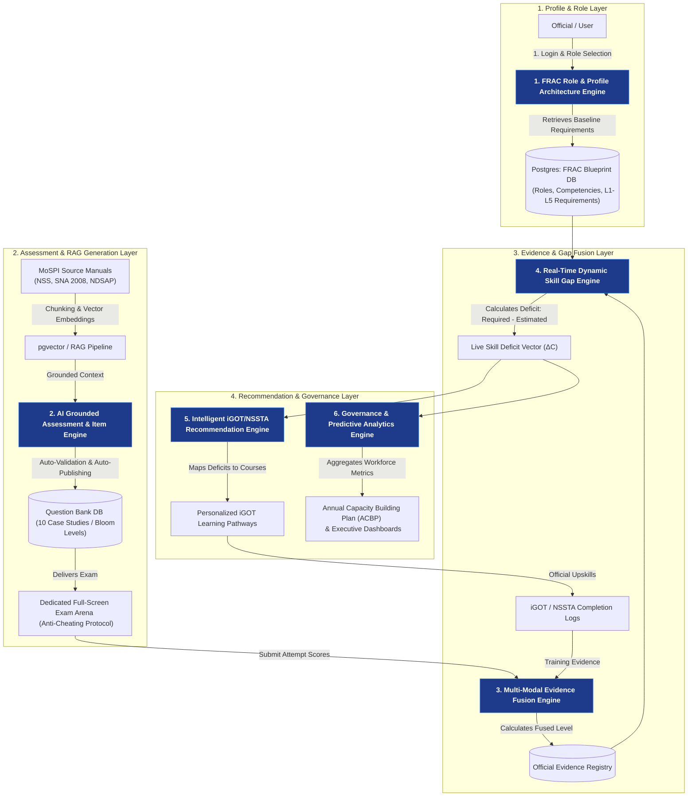

# 🏛️ Kshamata V2 — Technical System Architecture & Core Engines

This document presents the official **System Architecture & 6 Core Technical Engines** powering **Kshamata V2 (MoSPI Problem Statement 26101 Capacity Building System)**. It maps the end-to-end official user flow to technical system components.

---

## 📐 1. End-to-End Technical System Architecture

---

## ⚙️ 2. Detailed Breakdown of the 6 Core Technical Engines

### 1️⃣ Engine 1: FRAC Role & Profile Architecture Engine
* **User Flow Mapping**: Steps 1 & 2 (*Login & Profile Sync* ➔ *Competency Requirement Mapping*).
* **Technical Function**:
  - Ingests official designations (*Senior Statistical Officer*, *Assistant Director*, *Director*).
  - Maps roles to standard FRAC (Framework for Roles, Activities, and Competencies) blueprints across 4 domains (*Statistical*, *Technical*, *Digital Governance*, *Managerial*).
  - Assigns target baseline proficiency levels ($L_1$ to $L_5$).

---

### 2️⃣ Engine 2: AI Grounded Assessment & Item Generation Engine
* **User Flow Mapping**: Step 3 (*AI Competency Assessment*).
* **Technical Function**:
  - Ingests official MoSPI manuals (*NSS survey instructions, SNA 2008 national accounting rules, NDSAP privacy standards*).
  - Uses RAG vector retrieval to generate 10 deep, Codeforces-style multi-paragraph case-study problem statements.
  - Aligns questions to Bloom’s Taxonomy (`APPLY`, `ANALYZE`, `EVALUATE`).
  - Executes **Automated Quality Verification** (Schema, Logic, Grounding) and auto-publishes to the DB Question Bank.

---

### 3️⃣ Engine 3: Multi-Modal Evidence & Capability Fusion Engine
* **User Flow Mapping**: Steps 7 & 8 (*Re-Assess* ➔ *Competency Profile Updated*).
* **Technical Function**:
  - Collects multi-modal performance evidence:
    $$\text{Evidence} = \{ \text{Diagnostic Exam Scores}, \text{iGOT Course Logs}, \text{NSSTA Workshops} \}$$
  - Computes weighted Bayesian evidence fusion:
    $$E_{\text{fused}} = w_1 \cdot S_{\text{exam}} + w_2 \cdot S_{\text{iGOT}} + w_3 \cdot S_{\text{prior}}$$
  - Automatically updates estimated competency levels in real-time ($L_{\text{estimated}}$).

---

### 4️⃣ Engine 4: Real-Time Dynamic Skill Deficit & Gap Engine
* **User Flow Mapping**: Step 4 (*Evidence-Based Gap Analysis*).
* **Technical Function**:
  - Computes real-time competency gap vectors:
    $$\Delta C_i = \max\left(0, L_{\text{required}, i} - L_{\text{estimated}, i}\right)$$
  - Triggers instant gap recalculation whenever an official submits an assessment or changes assigned roles.
  - Classifies gap urgency: *Critical Deficit*, *Moderate Deficit*, *Target Met*.

---

### 5️⃣ Engine 5: Intelligent iGOT / NSSTA Recommendation Engine
* **User Flow Mapping**: Steps 5 & 6 (*Personalized Recommendations* ➔ *Learn & Upskill*).
* **Technical Function**:
  - Takes real-time gap vectors ($\Delta C_i$) and maps them to TPAC-approved **iGOT Karmayogi course modules** and **NSSTA training programmes**.
  - Uses cosine similarity matching between competency deficit vectors and course metadata embeddings.
  - Generates role-aware, prioritized learning pathways for each official.

---

### 6️⃣ Engine 6: Governance & Predictive Analytics Engine (ACBP)
* **User Flow Mapping**: Step 9 (*Dashboard & Insights*).
* **Technical Function**:
  - Aggregates workforce capability data across all MoSPI divisions (*FOD*, *NAD*, *DIID*, *ESD*, *SDRD*).
  - Auto-generates the **Annual Capacity Building Plan (ACBP)** report for ministry leadership.
  - Predicts future training demand trends using predictive analytics models.

---

## 🎨 3. Slide Summary Table (For Presentation)

| Engine Name | Input Data | Core Processing Logic | Output Artifact |
| :--- | :--- | :--- | :--- |
| **1. FRAC Profile Engine** | Designation, Department | FRAC Mapping Rules | Baseline Competency Blueprint |
| **2. AI Item Engine** | MoSPI Manuals, RAG Chunks | LLM + Auto-Validation Rules | Grounded Case-Study Question Bank |
| **3. Evidence Fusion Engine** | Exam Scores, iGOT Logs | Weighted Bayesian Fusion | Real-Time Estimated Level ($L_{\text{est}}$) |
| **4. Skill Gap Engine** | $L_{\text{required}}$, $L_{\text{estimated}}$ | Vector Subtraction ($\Delta C_i$) | Real-Time Deficit Gap Vector |
| **5. Recommendation Engine** | Deficit Vector ($\Delta C_i$) | Cosine Similarity Ranking | Targeted iGOT / NSSTA Learning Plan |
| **6. Governance Engine** | Ministry-wide Gap Vectors | Predictive Trend Modeling | Annual Capacity Building Plan (ACBP) |
