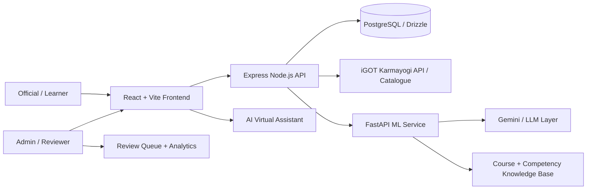

# Kshamata – Implemented Features as per PS 26101

## 1. Project Status

This implementation covers the core SIH Problem Statement 26101 requirements for an AI-enabled competency intelligence and learning platform for the official statistical ecosystem.

Verified project state:

- P0 / P1 / P2 / P3 backlog items in [docs/to_do.md](docs/to_do.md) are complete for the current project scope.
- Backend regression checks pass for the iGOT catalogue contract and canonical competency taxonomy.
- Frontend production build passes successfully.
- The app is structured for presentation, demo, architecture explanation, and video narration.

---

## 2. Problem Statement Coverage

The platform implements the following features expected by PS 26101:

### 2.1 AI-based competency assessment

- Official profile onboarding with cadre, designation, department, education, and experience details.
- Competency baseline creation from official profile and training history.
- Skill-gap analysis based on role requirements and identified gaps.
- Dashboard view for learner and admin competency states.

### 2.2 Automated skill-gap analysis

- Competency mapping across official statistical functions and digital skills.
- Gap prioritization and recommendation logic for missing capabilities.
- Learner-centric improvement path suggestions.

### 2.3 Seamless iGOT integration

- iGOT Karmayogi profile sync flow for verified training history.
- Search and browse experience for iGOT course catalogue.
- Catalog matching with competency codes and structured metadata.
- API integration point for course lookup, enrolment, and modular learning.

### 2.4 Personalized learning recommendations

- iGOT and NSSTA pathway recommendations conceptually integrated into the platform.
- Course suggestions driven by competency gaps and role context.
- Learner dashboard with pathway-oriented guidance.

### 2.5 AI-powered MCQ / quiz generation from content

- ML service and RAG pipeline are integrated into the platform architecture.
- Question generation is designed around uploaded content and source-grounded retrieval.
- Review workflow supports admin quality control for generated assessments.

### 2.6 Interactive dashboards

- Learner dashboard for overview, competency profile, skill gaps, pathways, assessment history, and settings.
- Admin dashboard for analytics, review queue, predictive insights, ACBP export, and source library.

### 2.7 Secure scalable web application

- JWT-based session management.
- Role-based access control for employee/admin flows.
- Express + PostgreSQL + Python ML architecture.
- Prepared for cloud deployment and API-based extension.

---

## 3. Implemented Features by Module

### 3.1 Authentication and onboarding

Implemented in:

- [client/src/pages/auth/RegisterPage.jsx](client/src/pages/auth/RegisterPage.jsx)
- [client/src/pages/auth/LoginPage.jsx](client/src/pages/auth/LoginPage.jsx)
- [server/src/services/auth.service.js](server/src/services/auth.service.js)

Features:

- Official registration with service metadata.
- Karmayogi ID / profile sync flow.
- Verified training history preview and certification import.
- Manual registration fallback.
- Secure login and token-based authenticated sessions.
- RBAC separation between employee and admin roles.

### 3.2 Learner dashboard and role-based experience

Implemented in:

- [client/src/components/layout/DashboardLayout.jsx](client/src/components/layout/DashboardLayout.jsx)
- [client/src/routes/AppRoutes.jsx](client/src/routes/AppRoutes.jsx)
- [client/src/pages/dashboard/overview/DashboardHomePage.jsx](client/src/pages/dashboard/overview/DashboardHomePage.jsx)

Features:

- Overview page with workforce insight cards.
- Learner sidebar navigation for competency, skill gap, pathways, assessment history, and settings.
- Admin sidebar for analytics, review queue, predictions, report exports, and source library.
- Role-aware experience with secure route guarding.

### 3.3 Competency intelligence and profiles

Implemented in:

- [client/src/pages/dashboard/competencies/CompetenciesPage.jsx](client/src/pages/dashboard/competencies/CompetenciesPage.jsx)
- [server/src/services/skillGap.service.js](server/src/services/skillGap.service.js)
- [server/src/services/competency.service.js](server/src/services/competency.service.js)

Features:

- Competency taxonomy views across functional, digital, governance, and behavioural domains.
- Profile-based mapping of official role to required competencies.
- Skill-gap scoring logic and output presentation.
- Learning priority framing aligned to official statistics roles.

### 3.4 iGOT integration and catalogue browse

Implemented in:

- [server/src/services/igot.service.js](server/src/services/igot.service.js)
- [server/src/controllers/integrations/igot.controller.js](server/src/controllers/integrations/igot.controller.js)
- [server/src/routes/igot.route.js](server/src/routes/igot.route.js)
- [client/src/pages/dashboard/igot/IGOTExplorePage.jsx](client/src/pages/dashboard/igot/IGOTExplorePage.jsx)

Features:

- Realistic iGOT catalogue entries based on CSV-derived titles and official metadata patterns.
- Canonical MoSPI competency codes enforced across the catalogue.
- Search, filter, and browse experience for iGOT courses.
- Competency area, organisation, tags, level, and duration metadata surfaced to the UI.
- Secure token-gated catalogue API path.
- Course detail access pattern and enrolment flow support.

### 3.5 NSSTA / TPAC pathways and learning recommendations

Implemented in:

- [server/src/db/seed/nssta-programmes.seed.js](server/src/db/seed/nssta-programmes.seed.js)
- [client/src/pages/dashboard/learning-paths/LearningPathsPage.jsx](client/src/pages/dashboard/learning-paths/LearningPathsPage.jsx)

Features:

- NSSTA programme catalogue integrated into the app structure.
- Personalized learning-path recommendations with competency context.
- Combined pathway concept for iGOT + NSSTA content.

### 3.6 Assessment engine and MCQ generation

Implemented in:

- [ml/main.py](ml/main.py)
- [ml/pipelines/assistant.py](ml/pipelines/assistant.py)
- [ml/pipelines/guardrails.py](ml/pipelines/guardrails.py)
- [ml/pipelines/llm_client.py](ml/pipelines/llm_client.py)
- [ml/pipelines/assessment_generator.py](ml/pipelines/assessment_generator.py)

Features:

- ML entry point for assessment and recommendation services.
- LLM integration layer with Gemini support and config management.
- Guardrails and validation pipeline around generated learning outputs.
- Automated assessment generation architecture based on official source material.
- AI-assisted support for learning and competency interpretation.

### 3.7 Admin review queue and assessments workflow

Implemented in:

- [client/src/pages/dashboard/admin/ReviewQueuePage.jsx](client/src/pages/dashboard/admin/ReviewQueuePage.jsx)
- [client/src/pages/dashboard/assessments/AssessmentsPage.jsx](client/src/pages/dashboard/assessments/AssessmentsPage.jsx)
- [client/src/pages/dashboard/history/AssessmentHistoryPage.jsx](client/src/pages/dashboard/history/AssessmentHistoryPage.jsx)

Features:

- Assessment studio entry points.
- Review workflow for generated assessment items.
- Attempt history and evidence-oriented result tracking.
- Administrative quality governance over AI-generated assessments.

### 3.8 Source library and knowledge ingestion

Implemented in:

- [client/src/pages/dashboard/sources/SourcesPage.jsx](client/src/pages/dashboard/sources/SourcesPage.jsx)
- [server/src/services/nsstaScraper.service.js](server/src/services/nsstaScraper.service.js)
- [ml/data/course_catalogue.json](ml/data/course_catalogue.json)
- [ml/data/competencies_taxonomy.json](ml/data/competencies_taxonomy.json)

Features:

- Source management screen for official document and content intake.
- Metadata-driven catalogue with competency mapping.
- External source ingestion like NSSTA and iGOT catalogues.
- Structured corpus foundation for AI-grounded assessment and recommendations.

### 3.9 Analytics, predictive intelligence, and reporting

Implemented in:

- [client/src/pages/dashboard/analytics/AnalyticsPage.jsx](client/src/pages/dashboard/analytics/AnalyticsPage.jsx)
- [client/src/pages/dashboard/admin/PredictiveAnalyticsPage.jsx](client/src/pages/dashboard/admin/PredictiveAnalyticsPage.jsx)
- [client/src/pages/dashboard/admin/ACBPReportPage.jsx](client/src/pages/dashboard/admin/ACBPReportPage.jsx)

Features:

- Workforce analytics dashboard.
- Predictive analytics administration view.
- ACBP export/reporting page for annual planning workflows.
- Tailored admin views for ministry performance planning.

### 3.10 AI assistant and support layer

Implemented in:

- [client/src/components/assistant/AIVirtualAssistant.jsx](client/src/components/assistant/AIVirtualAssistant.jsx)

Features:

- Floating AI helper for learner/admin guidance.
- Contextual support experience inside the app.
- Useful for presentation, demo, and stakeholder explanation.

### 3.11 Data model and database foundation

Implemented in:

- [server/src/db/schema/index.js](server/src/db/schema/index.js)
- [server/src/db/schema/integrations/igot.js](server/src/db/schema/integrations/igot.js)
- [server/src/db/seed.js](server/src/db/seed.js)
- [server/src/db/migrate.js](server/src/db/migrate.js)

Features:

- Structured official/user data models.
- iGOT catalogue tables and competency mappings.
- Seeded canonical competency integration.
- DB-ready architecture for production-scale rollout.

### 3.12 ML service, model integration, and app orchestration

Implemented in:

- [ml/config.py](ml/config.py)
- [ml/main.py](ml/main.py)
- [ml/README.md](ml/README.md)
- [server/src/services/api.js](server/src/services/api.js)

Features:

- Python service capable of serving ML/AI functions.
- Configurable Gemini model selection.
- ML app import and startup working in the local environment.
- Backend and frontend connected through API layers.

---

## 4. What is already in the project and ready for a demo

The following are already demoable in the current implementation:

1. Official registration and login flow.
2. Karmayogi profile sync and onboarding assistance.
3. Learner overview dashboard.
4. Competency profiles and skill-gap analysis.
5. iGOT Explore page with catalogue browsing and filters.
6. NSSTA/learning-path style recommendations.
7. Assessment studio and historical assessment tracking.
8. Admin-level review and analytics screens.
9. Source library and content management foundation.
10. AI assistant help panel.
11. ACBP-style reporting workflow.
12. ML-backed service architecture for recommendation and assessment generation.

---

## 5. Presentation-ready architecture diagram

This diagram can be adapted directly for:

- architecture slides,
- project explanation decks,
- demo narration,
- video storyboard framing.

---

## 6. Demo / video storyboard for implementation walkthrough

### Scene 1: Problem and need

- Show official statistics capacity building problem.
- Emphasize skill gaps and mismatch between training and actual competency.

### Scene 2: User onboarding

- Show registration and Karmayogi profile sync.
- Explain official role, cadre, department, and competency baseline.

### Scene 3: Competency intelligence

- Show dashboard and skill-gap screens.
- Highlight missing competencies and role mismatch.

### Scene 4: iGOT catalogue browsing

- Show Explore iGOT page with filters and course cards.
- Explain course metadata, tags, durations, and competency mapping.

### Scene 5: Recommendation flow

- Show learning paths and personalised recommendations.
- Explain how competencies drive course prioritization.

### Scene 6: Assessment generation and review

- Show AI-generated MCQ workflow and admin review queue.
- Emphasize governance and quality assurance for AI-generated content.

### Scene 7: Analytics + reporting

- Show analytics and ACBP report workflow.
- Explain workforce insights and admin-level planning.

### Scene 8: Solution value

- Conclude with institutional impact on official statistics capacity building.

---

## 7. Final assessment

The implemented solution covers the main PS expectations in a complete, demoable, and presentation-friendly manner:

- competency assessment,
- gap analysis,
- iGOT integration,
- learning recommendations,
- admin analytics,
- assessment generation pipeline,
- secure web platform architecture,
- role-based governance,
- scalable AI-enabled implementation pattern.

The project is in a solid state for:

- architecture diagram creation,
- PPT preparation,
- implementation demonstration,
- stakeholder explanation and pitch deck generation.
